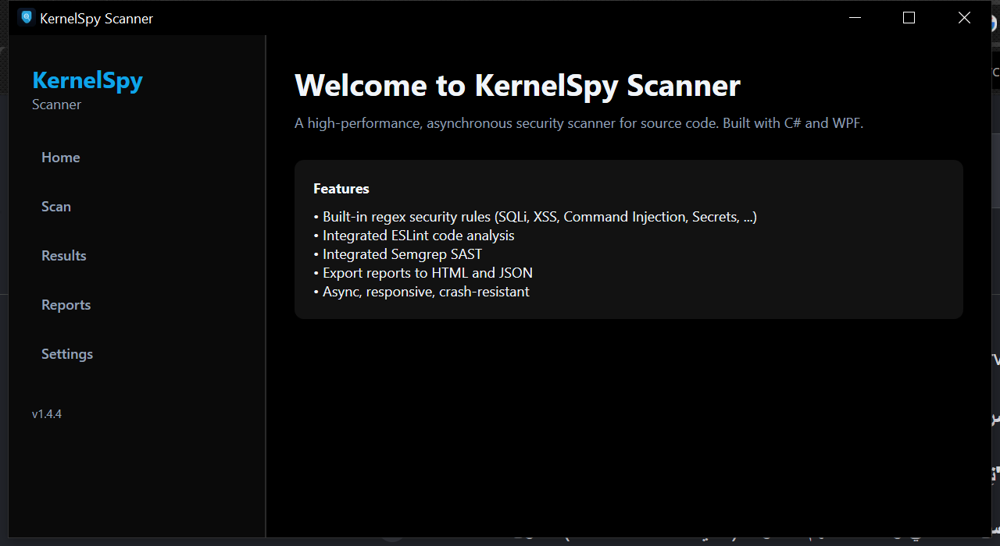

<div align="center">

# KernelSpy Scanner

### Offline security scanning for Windows


**A fast, fully offline SAST desktop scanner with a native dark WPF interface,
built-in pattern detection, ESLint, and Semgrep.**

</div>

---

## Overview

KernelSpy Scanner reads a source tree, applies layered detection rules, and
merges the results of the built-in engine with **ESLint** and **Semgrep** into a
single deduplicated findings view. It is designed for Windows, works without an
internet connection, and can be published with the complete .NET runtime and
all analyser binaries beside the executable.

The current Windows application is the **C# 13 / .NET 9 / WPF** edition in
[`wpf/`](wpf/). The original Python implementation is still in this repository.



## Highlights

- Deep-black UI, including the title bar, scrollbars, tables, and progress bar.
- Asynchronous scanning with live progress and cancellation.
- Pattern engine for injection, XSS, traversal, secrets, weak crypto, SSRF,
  XXE, unsafe deserialization, and framework misconfigurations.
- Inline suppressions (`kernelspy-ignore`) and sanitizer/placeholder filters.
- ESLint analysis for JavaScript and TypeScript using bundled Node.js.
- Semgrep analysis using a bundled native core and `Rules/kernelspy-semgrep.yml`.
- HTML and JSON report export.
- Self-contained `win-x64` deployment with no runtime downloads.
- Diagnostics and crash logs under `%LOCALAPPDATA%\KernelSpyScanner\logs`.

## Repository layout

| Path | Contents |
|:--|:--|
| [`wpf/`](wpf/) | Current C# / WPF application and its documentation |
| [`wpf/README.md`](wpf/README.md) | Build, run, packaging, and architecture details |
| [`wpf/KernelSpy_Scanner_WPF.iss`](wpf/KernelSpy_Scanner_WPF.iss) | Inno Setup installer definition |
| [`wpf/build-installer.ps1`](wpf/build-installer.ps1) | Publish, verify, and build the installer |
| [`main.py`](main.py), [`core/`](core/) | Original Python edition |
| [`docs/python-edition.md`](docs/python-edition.md) | Preserved Python edition README |
| `KernelSpy*.iss` | Installer definitions for the Python edition |

## Build the WPF edition

Requirements:

- Windows 10 or later, 64-bit
- [.NET 9 SDK](https://dotnet.microsoft.com/download/dotnet/9.0)
- [Inno Setup 6](https://jrsoftware.org/isinfo.php) for the installer
- The prepared analyser payload under `wpf/tools/`

```powershell
cd wpf

dotnet restore
dotnet build -c Release
dotnet run -c Release
```

To create a self-contained publish and the installer:

```powershell
./build-installer.ps1
```

The setup is written to
`wpf/installer/KernelSpy_Scanner_Setup_WPF_1.4.4.exe`. The build script verifies
the bundled runtime and analyser paths before it invokes Inno Setup, and it only
publishes the setup after a successful compile.

## Bundled tools payload

The `tools/` directory is **not committed**. It contains about **1.04 GB across
21,385 files**, which is unsuitable for a Git source repository. The application
expects this layout beside the executable:

```text
tools/
  node/node.exe
  eslint-10.13.0/eslint-10.13.0/bin/eslint.js
  semgrep-runtime/semgrep/bin/semgrep-core.exe
  semgrep-1.181.0/
```

Full instructions are in [`wpf/tools/README.md`](wpf/tools/README.md). The
application resolves the folder relative to the executable and its parents, so
running from `wpf/` picks up `wpf/tools/` automatically. If an external analyser
is missing, the built-in scanner still runs and reports the analyser as skipped.

## Reports

Findings can be exported from the **Reports** page as:

- **HTML** — styled, self-contained report with encoded source snippets.
- **JSON** — structured data for further processing or dashboards.

## Python edition

The original Python scanner remains available:

```powershell
pip install -r requirements.txt
python main.py
```

Its full documentation is preserved in
[`docs/python-edition.md`](docs/python-edition.md). The Python installer
definitions are the `KernelSpy*.iss` files at the repository root.

## Contributing

Issues and pull requests are welcome. For the WPF application, please include:

- Windows version and architecture
- The .NET SDK version used to build
- The affected page or analyser (built-in, ESLint, or Semgrep)
- Relevant lines from `%LOCALAPPDATA%\KernelSpyScanner\logs`

## License

MIT. See [LICENSE](LICENSE).
