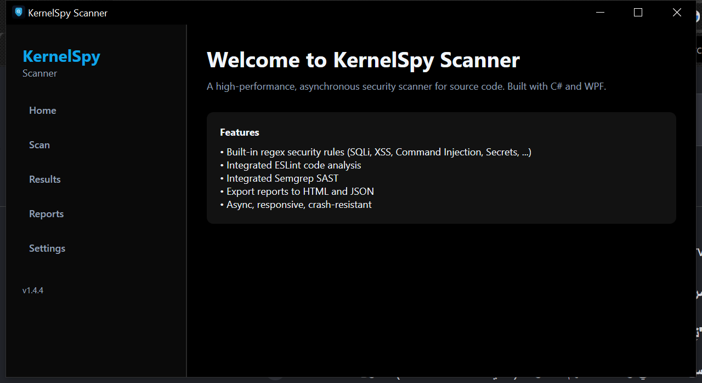
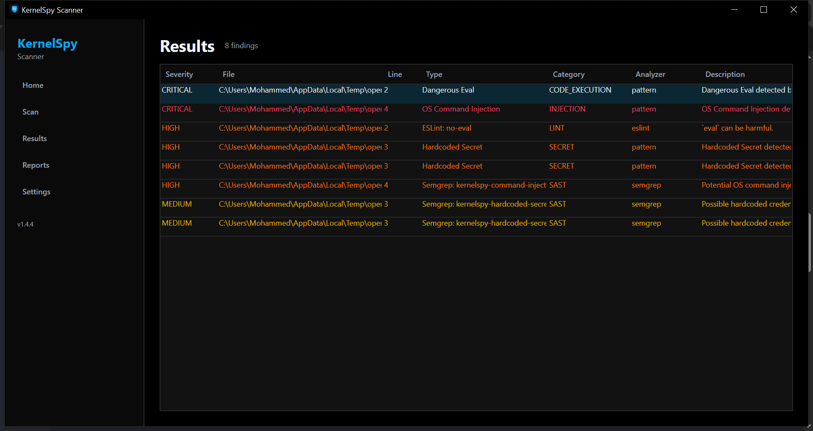

# KernelSpy Scanner — C# / WPF Edition

A complete Windows rewrite of the KernelSpy security scanner using **C# 13**,
**.NET 9**, and **WPF**. The application keeps the original layered detection
approach and adds **ESLint** and **Semgrep** analysers, merging everything into
one deduplicated result set.





## Highlights

- Deep-black WPF interface with a dark title bar, scrollbars, and data grid.
- Asynchronous scanning with live progress and cancellation.
- Built-in pattern engine covering injection, XSS, path traversal, secrets,
  weak cryptography, SSRF, XXE, and related classes of issues.
- Inline suppression comments (`kernelspy-ignore`) and sanitizer/placeholder
  filtering.
- ESLint integration for JavaScript and TypeScript.
- Semgrep integration through the bundled native `semgrep-core.exe` and the
  project rule pack in `Rules/kernelspy-semgrep.yml`.
- HTML and JSON report export.
- Fully self-contained `win-x64` publishing: the .NET runtime, Node.js, ESLint,
  Semgrep, and rules travel with the application.
- Global crash logging and startup diagnostics under
  `%LOCALAPPDATA%\KernelSpyScanner\logs`.

## Requirements

- Windows 10 or later, 64-bit.
- [.NET 9 SDK](https://dotnet.microsoft.com/download/dotnet/9.0) to build from
  source.
- [Inno Setup 6](https://jrsoftware.org/isinfo.php) to create the installer.
- A prepared `tools/` payload for the bundled ESLint and Semgrep analysers. See
  [`tools/README.md`](tools/README.md) for the exact layout. The payload is not
  committed because it is about 1 GB.

The published application does **not** require the .NET Desktop Runtime or any
separate Node.js / Python / Semgrep installation on the target machine.

## Build and run

From this folder:

```powershell
dotnet restore
dotnet build -c Release
dotnet run -c Release
```

Select a source folder on the **Scan** page, press **Start Scan**, then open
**Results**. Reports can be exported from the **Reports** page.

## Publish

```powershell
dotnet publish KernelSpyScanner.csproj -c Release -r win-x64 `
  --self-contained true -p:PublishSingleFile=false -p:PublishTrimmed=false `
  -o publish
```

The project is intentionally published as a folder rather than a single file:
the bundled tools payload is much larger than a practical single-file bundle,
and the application resolves `tools/` relative to the real executable
directory.

## Installer

```powershell
./build-installer.ps1
```

The script:

1. Publishes a self-contained `win-x64` build into `publish/`.
2. Verifies that the runtime, rules, Node.js, ESLint, and Semgrep core are
   present.
3. Compiles `KernelSpy_Scanner_WPF.iss` with Inno Setup into a staging folder.
4. Copies the finished setup to
   `installer/KernelSpy_Scanner_Setup_WPF_1.4.4.exe` only after a successful
   compile, so an interrupted build cannot leave a truncated installer.

The setup is large because it contains the complete standalone payload
(roughly 1.2 GB installed). Compile and install times depend heavily on disk
speed and real-time antivirus scanning.

## Bundled tools

The scanner never downloads tools at runtime. At startup it looks for `tools/`
next to the executable and in parent directories.

| Tool | Expected path |
|:--|:--|
| Node.js | `tools/node/node.exe` |
| ESLint | `tools/eslint-10.13.0/eslint-10.13.0/bin/eslint.js` |
| Semgrep core | `tools/semgrep-runtime/semgrep/bin/semgrep-core.exe` |
| Semgrep source | `tools/semgrep-1.181.0/` |
| Semgrep rules | `Rules/kernelspy-semgrep.yml` |

If one of the optional external analysers is missing, the built-in engine still
runs and the skipped analyser is reported in the UI.

## Project structure

```text
KernelSpyScanner.csproj          WPF application project (.NET 9, win-x64)
App.xaml / App.xaml.cs           Bootstrap, theme loading, crash logging
MainWindow.xaml / .cs            Shell, scan, results, reports, settings
Themes/DarkTheme.xaml            Dark design system and control templates
Models/Finding.cs                Finding model
Engine/AppPaths.cs               Dynamic bundled-resource resolution
Engine/Patterns.cs               Built-in detection rules
Engine/Scanner.cs                Async scan orchestration and deduplication
Integrations/EslintRunner.cs     Bundled Node.js + ESLint adapter
Integrations/SemgrepRunner.cs    Native Semgrep core adapter
Reporting/HtmlReport.cs          Styled HTML export
Reporting/JsonReport.cs          Structured JSON export
Rules/kernelspy-semgrep.yml      Semgrep rule pack
Rules/eslint.config.mjs          ESLint flat configuration
KernelSpy_Scanner_WPF.iss        Inno Setup definition
build-installer.ps1              Publish + verify + installer build
tools/README.md                  Instructions for the external tools payload
```

## Detection coverage

The built-in engine includes rules for:

- code execution and dangerous `eval` / command execution
- SQL injection, NoSQL injection, and LDAP injection
- cross-site scripting and unsafe HTML rendering
- path traversal and unrestricted file access
- hardcoded secrets, API keys, tokens, and private keys
- weak hashing, weak ciphers, and insecure random generation
- SSRF, XXE, unsafe deserialization, and permissive CORS
- debug flags, verbose errors, and common framework misconfigurations

ESLint contributes JavaScript/TypeScript lint findings. Semgrep contributes the
rules in `Rules/kernelspy-semgrep.yml`, including dangerous eval and command
injection patterns.

## Security notes

The scanner is defensive tooling. It never executes the source code it scans.
It only reads text files and invokes the external analysers in read-only modes.
Source snippets are HTML-encoded before being written to reports.

## License

MIT. See the repository [LICENSE](../LICENSE).

The original Python edition remains available at the repository root; its
documentation is preserved in [`docs/python-edition.md`](../docs/python-edition.md).
